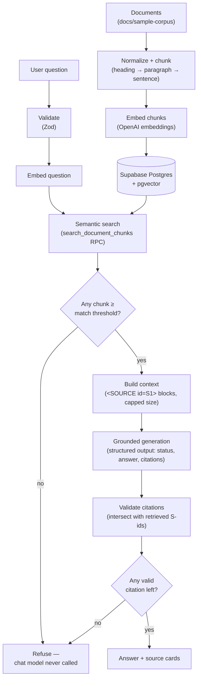

# DocuMind

AI knowledge assistant for technical documentation. DocuMind answers
questions strictly from a curated, pre-indexed set of documents and shows
exactly which passages it used — if the answer isn't in the knowledge base,
it says so instead of guessing.

This is a portfolio project. It is a local MVP: no production deployment,
no public document upload, no admin panel. The document base is a fixed,
five-document synthetic corpus checked into the repo.

## Portfolio goals

The point of this project is to demonstrate a real retrieval-augmented
generation system, end to end, with the parts that are easy to fake done
properly instead:

- Real semantic chunking (heading → paragraph → sentence → hard limit), not `text.slice`.
- Real pgvector retrieval with a tunable similarity threshold.
- A retrieval-layer refusal gate: the chat model is never called when nothing relevant was found.
- Citations the app validates itself, never citations it trusts from the model.
- A documented, isolated local demo mode so the whole pipeline is exercisable without any API keys.

## Architecture

```
Next.js App Router (TypeScript, strict)
├─ app/                  UI routes (landing, chat shell, API routes)
├─ components/           Chat UI, source cards, small UI primitives
├─ lib/
│  ├─ ai/                AIProvider interface: OpenAI + deterministic mock
│  ├─ rag/                Chunking, retrieval, context, prompt, citations, pipeline
│  ├─ store/              Chat persistence: Supabase + in-memory fallback
│  ├─ supabase/           Server-side Supabase client (service role)
│  └─ validation/         Zod schemas at every external boundary
├─ scripts/
│  ├─ ingest/             npm run ingest — populates Supabase/pgvector
│  └─ eval/               npm run eval:retrieval (retrieval-only) + npm run eval:rag (full)
├─ supabase/migrations/   SQL schema, pgvector index, retrieval RPC
├─ docs/sample-corpus/    5 synthetic Markdown documents
├─ evals/rag-eval.json    20-case evaluation dataset
└─ tests/                 Focused unit/integration tests
```

Every module that touches a secret or a real network call — the OpenAI
client, the Supabase service-role client, the chat store, the pgvector
retrieval backend — is marked `import "server-only"` and is never imported
by a client component. `scripts/ingest` and `scripts/eval` are standalone
CLI entry points (run with `tsx`, outside the Next.js server runtime) and
deliberately build their own thin OpenAI/Supabase clients instead of
importing those guarded modules — the `server-only` package throws
unconditionally outside Next's bundling condition, so reusing it there
would break the scripts. They do reuse the pure, secret-free RAG logic
(chunking, prompt, context building, citation validation).

## RAG flow



The single most important property in this diagram is the branch at "Any
chunk ≥ match threshold?": when it's "no", generation is skipped entirely —
refusal is a retrieval-layer decision, not something the model is asked to
volunteer. See [src/lib/rag/pipeline.ts](src/lib/rag/pipeline.ts).

## Tech stack

Next.js (App Router) · React · TypeScript (strict) · Tailwind CSS ·
hand-built UI primitives + Lucide icons · Zod · OpenAI SDK · Supabase JS ·
PostgreSQL + pgvector · Vitest.

## Project structure

See [Architecture](#architecture) above for the directory layout.

## Sample corpus

Five original synthetic documents in [docs/sample-corpus](docs/sample-corpus),
written to read like real internal IT documentation for a small company
("Northwind Field Services"), with deliberately overlapping topics so
cross-document questions have a real answer:

- **network-operations-guide.md** — monitoring, change management, incident escalation, wireless standards.
- **workstation-support-policy.md** — provisioning, patching, workstation backups, hardware refresh.
- **access-management-policy.md** — provisioning, privileged access, access reviews, offboarding, MFA.
- **backup-recovery-runbook.md** — backup schedule, verification, server restoration, disaster recovery, retention.
- **incident-response-handbook.md** — severity levels, response roles, response procedure, post-incident review.

## Document ingestion

```bash
npm run ingest
```

Runs `scripts/ingest/index.ts` against Supabase + OpenAI. It is idempotent:
each document is upserted by a stable `slug`, its existing chunks are
deleted, and chunks are rebuilt from scratch — re-running never
accumulates duplicates. If `NEXT_PUBLIC_SUPABASE_URL`,
`SUPABASE_SERVICE_ROLE_KEY`, or `OPENAI_API_KEY` are missing, it prints
`SKIPPED — missing external credentials` and exits 0 rather than failing —
see [Local demo mode](#local-demo-mode).

## Chunking strategy

Implemented in [src/lib/rag/chunk.ts](src/lib/rag/chunk.ts). Boundary
priority: **heading → paragraph → sentence → hard character limit**, only
falling all the way to a character-level cut for a run of text with no
sentence punctuation at all. Target chunk size is ~800 tokens (~4
chars/token), with a ~130-token overlap carried into the next chunk when a
section has to split, so retrieval doesn't lose context right at a cut
point. Each chunk keeps its document title, section heading, and index;
the demo corpus is Markdown with no page numbers, so `page_number` is
`null` and the citation locator is document + section instead.

## Embeddings

Ingestion embeds in one batched API call per document
(`OPENAI_EMBEDDING_MODEL`, default `text-embedding-3-small`, 1536
dimensions). Embedding only ever happens server-side (ingestion script, or
the server route handling a live query) — the key never reaches the
browser.

## pgvector retrieval

`supabase/migrations/0001_init.sql` defines `search_document_chunks(query_embedding, match_threshold, match_count)`,
a `stable sql` function using pgvector's `<=>` cosine-distance operator
(`similarity = 1 - distance`), filtered to `documents.is_active = true` and
`similarity >= match_threshold`, with `match_count` clamped to at most 50.
An HNSW index (`vector_cosine_ops`) backs the search. The app layer
([src/lib/rag/retrieval.ts](src/lib/rag/retrieval.ts)) assigns local `S1..SN`
citation labels in similarity order — the database UUID is never exposed
as a citation.

The real-mode default `RAG_MATCH_THRESHOLD` (0.72) is currently a
**reasoned default, not a measured one** — calibrating it against real
`text-embedding-3-small` similarity scores requires `npm run
eval:retrieval` against a real Supabase project, which hasn't been
possible in any environment this project has been built/verified in so
far (see [Local Supabase](#local-supabase)). Run that script and read off
the threshold sweep table before trusting 0.72 in a real deployment.

## Grounding strategy

[src/lib/rag/pipeline.ts](src/lib/rag/pipeline.ts) is the single entry
point. If retrieval returns nothing above threshold, **the chat model is
never called** and the user gets a plain refusal. If it is called, the
system prompt ([src/lib/rag/prompt.ts](src/lib/rag/prompt.ts)) requires a
structured `{status, answer, citations}` response, forbids outside
knowledge, and explicitly frames the `<SOURCE>` blocks as untrusted data,
not instructions.

## Citation validation

The model's `citations` array is never trusted directly. After generation,
[src/lib/rag/citations.ts](src/lib/rag/citations.ts) intersects it with the
`S1..SN` ids retrieval actually returned; anything else (e.g. a fabricated
`S99`) is dropped and logged. An `"answered"` status with zero surviving
citations is treated as ungrounded and downgraded to the same refusal
response a failed retrieval produces — a grounded-looking answer is never
shown without at least one real, validated citation.

## Prompt-injection protection

Document content is explicitly framed in the system prompt as untrusted
data the model must reason about but never obey. On top of that,
[src/lib/rag/context.ts](src/lib/rag/context.ts) HTML-escapes any literal
`<`/`>` characters inside a chunk's content before it's wrapped in
`<SOURCE>` tags, so a malicious chunk containing a literal `</SOURCE>`
can't forge a fake tag boundary and make injected text look like it sits
outside the untrusted block. The model has no tools, no filesystem, no
shell, no SQL access, and no web access — its only inputs are the question
and the retrieved context, and its only output is the structured answer
object.

## Database schema

- **documents** — `id, title, source, file_path, description, slug (unique), is_active, metadata, created_at`.
- **document_chunks** — `id, document_id → documents (cascade), chunk_index, content, page_number, section, metadata, embedding vector(1536), created_at`, with `unique(document_id, chunk_index)`.
- **chat_sessions** — `id, user_id (nullable — no auth model in this MVP), title, created_at, updated_at`.
- **chat_messages** — `id, session_id → chat_sessions (cascade), role, content, sources jsonb, model, retrieval_success, created_at`. `sources` is a snapshot of the validated `SourceCard[]`, so a reload shows the same citations without re-querying pgvector.
- Indexes: the `unique(document_id, chunk_index)` constraint already covers that lookup; plus `chat_messages(session_id, created_at)`, `chat_sessions(updated_at desc)`, and an HNSW `vector_cosine_ops` index on `document_chunks.embedding`.
- RLS is enabled on all four tables with no policies — the app never grants the browser direct table access; every read/write goes through the server using the service-role key.

Full SQL: [supabase/migrations/0001_init.sql](supabase/migrations/0001_init.sql).

## Vector dimension

`OPENAI_EMBEDDING_MODEL` defaults to `text-embedding-3-small`, which
outputs **1536** dimensions — the migration declares `embedding
vector(1536)` to match. If you switch to a model with a different output
dimension, update the `vector(N)` in the migration (and the HNSW index)
and re-run `npm run ingest` from scratch; a dimension change is not
backward-compatible with existing rows.

## Environment variables

See [.env.example](.env.example) for the full list with comments. Summary:

| Variable | Purpose |
|---|---|
| `NEXT_PUBLIC_SUPABASE_URL` / `NEXT_PUBLIC_SUPABASE_ANON_KEY` | Supabase project URL/anon key |
| `SUPABASE_SERVICE_ROLE_KEY` | Server-only — never sent to the browser |
| `OPENAI_API_KEY` | Server-only |
| `OPENAI_CHAT_MODEL` / `OPENAI_EMBEDDING_MODEL` | Model selection |
| `RAG_MATCH_THRESHOLD` / `RAG_MATCH_COUNT` / `RAG_CONTEXT_MAX_CHARS` | RAG tuning, mode-aware defaults |
| `DOCUMIND_MOCK_AI` | Force local demo mode even with real credentials present |

## Local setup

```powershell
cd C:\projects\DocuMind
npm install
copy .env.example .env.local
```

Fill in `.env.local` with real Supabase + OpenAI credentials for the full
pipeline, or leave it as-is to run in [local demo mode](#local-demo-mode)
with no external services at all.

## Local Supabase

```powershell
npm run db:start   # supabase start (requires Docker)
```

This project was built and has twice been verified in an environment with
**Docker not installed at all** (no `docker` command, no Docker Desktop
under `C:\Program Files`, no WSL2 distribution registered) — confirmed by
directly checking, not assumed. So the local Supabase stack has never
actually been started or verified against a real database; this is a
documented, environment-specific blocker, not a gap in the schema or app
code. The migration in `supabase/migrations/0001_init.sql` is ready to
apply either locally (`supabase start` + `supabase db reset`, or
automatically on `supabase start`) or against a real Supabase project
(`supabase link` + `supabase db push`, or pasting the SQL into the
Supabase SQL editor).

Once Docker (with the WSL2 backend, on Windows) is installed, the full
real pipeline can be brought up with:

```powershell
cd C:\projects\DocuMind
npx supabase init          # only if supabase/config.toml doesn't exist yet
npx supabase start
npx supabase db reset      # applies supabase/migrations/0001_init.sql
npx supabase status        # copy the local API URL + service_role/anon keys
copy .env.example .env.local
# paste the local Supabase URL/keys and a real OPENAI_API_KEY into .env.local
npm run ingest
npm run eval:retrieval     # cheap: embeddings + pgvector only, no chat completions
npm run eval:rag           # full: adds real chat generation + citation check
npm run dev
```

## Ingestion command

```bash
npm run ingest
```

See [Document ingestion](#document-ingestion) above.

## Development

```bash
npm run dev          # start the Next.js dev server
npm run lint          # eslint
npm run typecheck     # tsc --noEmit
npm run build          # production build
```

## Tests

```bash
npm run test
```

20 focused unit/integration tests (Vitest) covering the logic that
actually protects the RAG contract, not UI snapshots or framework
behavior: chunking (sectioning, overlap, hard-splitting a run with no
sentence breaks), question validation, citation validation (unknown
`S99` ids are stripped, an ungrounded "answered" is never trusted),
context construction (SOURCE markup, the character budget), source
mapping (`S1..SN` labels never leak a database UUID), the grounding gate
in the RAG pipeline (the chat model is provably never called when
retrieval finds nothing, via a mocked provider), the structured-answer
Zod schema (malformed responses rejected), and the prompt-injection
boundary (a forged `</SOURCE>` tag inside document content is neutralized,
and the deterministic mock provider never treats embedded text as an
instruction). No large low-value test suite was created solely for
coverage — see `tests/`.

## RAG evaluation

This is a local evaluation/regression dataset for this portfolio project,
not a scientific benchmark — 20 hand-written cases against a 5-document
corpus. Treat any numbers from it as a measured local baseline, not a
general accuracy claim.

`evals/rag-eval.json` has 20 cases: 8 direct, 4 paraphrased, 3
cross-document/cross-section, 3 out-of-scope, 1 false-premise, and 1
prompt-injection case. Both scripts below need real credentials and print
`SKIPPED — missing external credentials` (exit 0, never a faked pass)
without them — as of this writing that is their actual status in this
environment; see the build reports for exact command results.

```bash
npm run eval:retrieval   # embeddings + pgvector only — no chat-completion calls
```

`scripts/eval/run-retrieval-eval.ts` embeds each question, queries
`search_document_chunks` unfiltered (`match_threshold=0`, top 10) so the
real similarity distribution is visible, and reports Top-1/Top-3/Top-5 hit
rate on the answerable cases plus a threshold-sweep table (candidate
thresholds from 0.5–0.85) showing the recall/false-positive tradeoff at
each one. This is the intended way to calibrate `RAG_MATCH_THRESHOLD` from
real numbers instead of guessing — it does not call the chat model, so
it's cheap to re-run.

```bash
npm run eval:rag         # adds real chat generation + citation validation
```

`scripts/eval/run-eval.ts` runs each case through the full real OpenAI +
Supabase pipeline (embedding → retrieval → generation → citation
validation) and reports retrieval hits, refusal correctness, and citation
integrity as PASS/FAIL per case.

## Local demo mode

If OpenAI or Supabase credentials are missing — or `DOCUMIND_MOCK_AI=true`
is set explicitly — DocuMind runs entirely locally, with no external
services:

- **Embeddings**: a deterministic hashed, stemmed, stopword-filtered
  bag-of-words vector ([src/lib/ai/mock-provider.ts](src/lib/ai/mock-provider.ts)).
  It is a lexical-overlap proxy, not real semantic understanding — some
  heavily paraphrased questions that a real embedding model would match
  correctly will not match in mock mode. This is a known, accepted
  limitation of the demo mode, not the production retrieval path.
- **Retrieval**: an in-memory index built from `docs/sample-corpus` at
  first request, cosine-similarity ranked, no database involved
  ([src/lib/rag/mock-backend.ts](src/lib/rag/mock-backend.ts)).
- **Generation**: rule-based extraction from the top retrieved sources —
  not a language model, and specifically chosen to prove it doesn't and
  can't "follow" instructions embedded in document content
  ([src/lib/ai/mock-provider.ts](src/lib/ai/mock-provider.ts)).
- **Chat history**: an in-process store, keyed by `globalThis` so it
  survives Next.js Fast Refresh; it does **not** survive a dev server
  restart (unlike `SupabaseChatStore`, the real implementation used
  whenever credentials are present).

This exists so the full pipeline — retrieval, the refusal gate, citation
validation, chat, history — is demonstrable end to end with zero setup.
It is never selected when real credentials are configured, and it never
silently degrades a real deployment; see `useMock` in
[src/lib/config.ts](src/lib/config.ts).

## Demo questions

- **Direct**: "What is the escalation process for a critical network incident?"
- **Combined (cross-document)**: "What should an engineer do after a server incident if backup restoration is also required?"
- **Out-of-scope (refusal)**: "What is the current price of a Microsoft 365 subscription?"

## Known limitations

**Critical before a portfolio demo:**
- No live Supabase/OpenAI verification has been possible in any environment this project has been built in so far — Docker is confirmed not installed (checked directly, twice), and no API credentials have been provided. `RAG_MATCH_THRESHOLD` is therefore still a reasoned default, not a measured one. See the build reports for exactly what was and wasn't run each session.

**Recommended later:**
- The mock embedding is lexical, not semantic — expect it to under-perform on heavy paraphrases; this doesn't apply once real credentials are configured.
- No streaming — answers arrive as a single response, a deliberate tradeoff to keep citation validation simple and correct (see the project brief).
- Chat history in mock mode is in-memory only.

**Production-only (intentionally out of scope for this MVP):**
- Public document upload, an admin/document-management panel, authentication/multi-tenant auth, deployment, and monitoring.

## Next steps

Install Docker (with WSL2 on Windows), bring up local Supabase, and run
`npm run ingest` → `npm run eval:retrieval` → `npm run eval:rag` — in that
order, cheapest first — to get an actual measured baseline for the
retrieval threshold and prompt instead of the current reasoned defaults.
